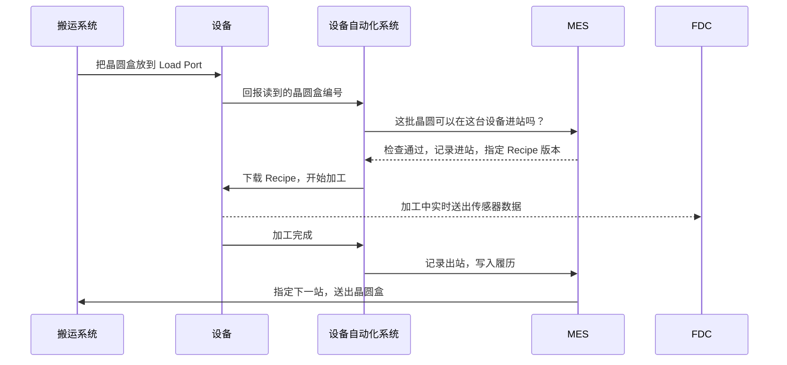

<!-- source: zh-TW/6-beyond-the-fab/23-fab-systems/README.md | sha: b9104fda5c2e -->

# 第 23 章　工厂如何被系统管理：一片晶圆为什么不会走错路

> 📍 **晶圆位置**
>
> - 前一站：跟着晶圆走完了整趟旅程
> - **本章：从系统的角度重新看一次工厂**
> - 下一站：芯片出货后，工艺如何影响固件

---

## 一座不可能靠人记住的工厂

前面二十二章，我们跟着一片晶圆从沙子走到封装。这一章换个位置：站在工厂中央，看它怎么被管住。

一座 300 mm 晶圆厂里，同时在生产中的晶圆有好几万片，换算成数千批；每一批平均还要走数百个步骤；厂内数百到上千台设备，各有自己的状态、腔体、Recipe 和保养排程。

只算「这批下一步去哪」就有数百种答案；再加上「哪一台做」「哪个版本的 Recipe」「现在能不能做」，这个组合已经到了记不住的量级。

这是组合爆炸，不是记性问题。

而且工厂不是静止的：设备会故障、会保养、会被测量结果停用；产品会加急、会被扣留。任何变动，都会让排好的顺序失效一次。

所以现代晶圆厂的做法不是「想办法记住」，而是「不要让任何人需要记住」：状态进系统，规则写成程序，人只判断例外。

工厂里的在制品叫 WIP，是厂长每天最先看的数字之一：太少，设备会闲着；太多，每一片都要排更久。

---

## 为什么单位是「批」，不是「片」

系统追踪的最小单位不是一片晶圆，是一批。

一片晶圆在厂里要走两三个月，若每一片都独立派工、独立记录，记录量是批次追踪的二十五倍，好处却几乎是零——同一批的二十五片，走同一条路、同一台设备、同一个 Recipe，连测量都只抽几片代表整批。

批也是实体单位。晶圆装在盒子里移动，一个前开式晶圆传送盒（Front Opening Unified Pod，FOUP）装二十五片，天车搬的是盒子，不是片子。系统若以「片」为单位，每次搬运都要重新对应「这二十五片在哪个盒子里」，多一层出错机会。

批也是责任单位：出了问题，被扣下、要检讨的都是整批。

---

## 工厂里的主要系统

| 系统 | 负责什么 | 比喻 |
|---|---|---|
| MES（制造执行系统） | 记录每批晶圆在哪里、下一步是什么，控制每一次进出站 | 工厂的大脑和账本 |
| 设备自动化系统 | 连接设备与 MES，下载 Recipe、启动工艺、收集数据 | 设备的翻译员 |
| 物料搬运系统 | 指挥天车和仓储，把晶圆盒送到正确的位置 | 物流中心 |
| 派工系统 | 决定每台设备下一批要做哪一批晶圆 | 交通信号灯 |
| Recipe 管理系统 | 管理每台设备的 Recipe 和版本 | 食谱数据库 |
| 工艺控制系统 | SPC、FDC、R2R，监控与控制工艺质量 | 质量控制员 |
| 良率分析系统 | 集成工艺和测试数据，分析良率 | 侦探 |
| 设备状态管理 | 追踪设备是生产、待机、保养还是故障 | 打卡机 |
| 数据平台 | 把设备、测量、测试的数据收进同一个地方 | 仓库 |
| 报表与看板 | 把数据变成每天要看的那几个数字 | 仪表板 |

十个系统里只有一个是「记录的正本」，就是 MES；其他系统各负责一件事，都不持有最终真相。

这个分工最容易被破坏。只要有人为了方便，在别的系统里也存一份「这批应该在哪」，工厂就有第二个真相——两个真相一定会分岔，分岔那天就是账实不符。

> [!NOTE]
> **📖 名词｜MES（Manufacturing Execution System，制造执行系统）**
>
> - **定义**：管理生产现场的核心系统，记录每批晶圆的位置、状态与历程，并控制晶圆能不能进入下一个步骤。
> - **现场用法**：「MES 上这批显示 Hold，要先查原因。」
> - **相关名词**：Track-in、Track-out、Route、Hold、派工
> - **常见混淆**：MES 不等于工厂的所有系统。它是核心，但设备连接、搬运、派工、工艺控制通常由其他系统负责，彼此互相配合。

---

## 系统的骨架：谁有权，谁只是传话

上面那张表拆开，只有三种角色。

**记录**：MES。它知道这批晶圆现在在哪、走过哪些站、下一步是什么；这是正本，其他系统都要能和它对上。

**命令**：也是 MES 发出的。MES 说「可以进站」，设备才会动；MES 说「用第三版 Recipe」，设备才下载第三版。

**手脚**：设备自动化系统、搬运系统、设备本身。它们执行，但不判断。设备只认得「现在要做什么」，不认得「这批该不该做」。

这个分界是工厂运作的基础。一旦执行者也能判断，责任就散了。

最常见的破口是「缓存」。设备自动化系统为了效率，会把 Recipe 清单暂存在自己这一方；暂存没错，错的是没有失效机制。MES 改了版，缓存还留着旧的，下次进站就用错版本——而系统记录的版本是对的，实际跑的是旧的。

第二个破口是面板上的手动修改。工程师把某个时间参数改长两秒，机器照做，产品也过了，但修改不会回写 MES。三个月后客户问「这批的实际条件」，工厂答不出来。

所以版本管理不是文件管理，是权限管理：谁能改、改了要不要重验、旧版留不留。没处理好，Recipe 只是看起来整齐的文件。

---

## 一批晶圆到站时，发生了什么事

以一批晶圆抵达一台刻蚀机为例：

1. 天车把晶圆盒放到设备的 Load Port，设备读取晶圆盒上的编号。
2. 系统逐一确认：这批晶圆现在应该在这一站吗？这台设备可以做这个产品吗？设备状态正常吗？晶圆有没有被 Hold？Q-Time 有没有超过？晶圆盒的污染等级和设备相符吗？
3. 确认通过后，系统才把正确版本的 Recipe 下载到设备，并核对版本编号。
4. 系统记录**进站**，设备开始加工。
5. 加工过程中，设备把传感器数据实时送给 FDC 监控。
6. 加工完成后记录**出站**，把使用的设备、腔体、Recipe、时间写入这批晶圆的履历。
7. 系统依 Route 决定下一站；如果需要测量，先送测量站，结果回写之后才继续。
8. 搬运系统把晶圆盒送过去，或先送进仓储等待。

注意顺序：**先确认，才下 Recipe**。反过来先把 Recipe 放着，设备可能自己开始跑——那时这批可能已被 Hold、超过 Q-Time，或改派到别的站。Recipe 放在设备上，就是一个随时会被执行的指令。

> [!NOTE]
> **📖 名词｜进站与出站（Track-in / Track-out）**
>
> - **定义**：进站是晶圆开始在某一站加工时，在系统上的登记；出站是完成加工后的登记，并把晶圆推进到下一个步骤。
> - **现场用法**：「这批进站之后设备就 Down 了，要处理一下帐。」
> - **相关名词**：MES、Route、履历
> - **常见混淆**：系统上的状态和实物晶圆必须一致。系统显示已出站、但晶圆其实还没做完，就是现场说的「账实不符」，必须立即处理。

设备来自不同厂商，业界因此制定共同的通信标准，最常见的是 **SECS/GEM**。没有它，每台设备都要写专属连接程序；标准的价值不在技术高明，而在让「换设备」变成可预期的事。

---

## 防呆：让错误无法发生

第 2 步的每一项确认，都是一条**防呆规则**。例如：

- 晶圆不在这一站，就不能进站。
- 设备没有通过验证，就不能做这个产品。
- Recipe 版本不对，就不能开始。
- Q-Time 超过、或晶圆被 Hold，就不能继续。
- 接触过铜的晶圆盒，不能放上前段的设备。

这些规则其实分成四个层次，越往上越可靠：

| 层次 | 做法 | 挡下什么 |
|---|---|---|
| 物理 | 不同尺寸的晶圆盒放不进装载端口；气体接头规格不同 | 接错、放错、装错 |
| 设备 | 设备读到不认得的产品编号就不启动 | 跑错产品、用错程序 |
| 系统 | MES 检查站点、Recipe、Q-Time、Hold、污染等级 | 走错路、带病进站 |
| 流程 | 两人复核、例外申请单、变更审查 | 判断失误、图省事 |

物理防呆最好，因为它不依赖任何人记得；系统防呆次之，它依赖规则写得对；流程最弱，因为它依赖人在疲倦时照做。但流程不能拿掉——总有系统没预期到的状况，重点是判断要留下记录。

> [!TIP]
> **🔧 Know-how｜每一条防呆规则背后，通常都有一次事故**
>
> - **情境**：急件赶着出货，有人希望暂时跳过某个系统检查。
> - **做法**：例外处理必须经过正式的申请和核准，并且留下记录，事后也要检讨规则是否需要调整。
> - **为什么**：很多规则都是从过去的事故学来的。规则看起来麻烦，往往是因为它挡下的错误很少再发生，大家已经忘了它为什么存在。
> - **没做会怎样**：同样的事故再次发生，而且因为规则被跳过，事后也很难追查。
> - **相关章节**：[第 18 章 异常处理与工程变更](../../4-yield-and-quality/18-abnormality-handling/README.md)

---

## Q-Time：一条看不见的时钟

工厂里有一类规则不是「不能做」，而是「不能等」。两个步骤之间允许等待的最长时间叫 Q-Time；它不是产能手段，是材料科学的要求：晶圆停在空气里，表面会一直变。

- 清洗完、还没进炉管的晶圆，表面会重新长出原生氧化层，也会吸附有机物。
- 光刻曝光完、还没显影的晶圆，光刻胶里的酸会继续扩散，图形会慢慢变形，也就是[第 4 章](../../2-process-modules/04-lithography/README.md)讲的曝后等待时间。
- 刻蚀完的晶圆，暴露出来的金属或硅表面会被空气和水气腐蚀。
- 沉积完的多孔薄膜会吸水，后面的工艺会出气、会剥离。

变化速度差很大，有些能等几小时，有些只有几十分钟，所以 Q-Time 是每段路径各自订的。超时也不是「一定坏」，是「坏的机率上升」——这让它特别难管：超时的晶圆外观正常、测量也过，问题要到后段甚至测试才出现。

所以工厂把它交给系统：每批剩余时间都算得出来，派工把快超时的排前面，超过的直接挡下。

> [!NOTE]
> **📖 名词｜Q-Time（Queue Time，等待时间限制）**
>
> - **定义**：两个步骤之间允许等待的最长时间，超过就必须挡下、返工或报废。
> - **现场用法**：「这批 Q-Time 只剩四十分钟，先跑它。」
> - **相关名词**：原生氧化层、PED、派工、Hold
> - **常见混淆**：Q-Time 讲的是「两个特定步骤之间」的限制，不是整个流程的总时间。整批从投片到完成花的时间叫 Cycle Time，两者常被混着讲。

---

## 履历：每一片晶圆的完整记录

系统为每一片晶圆留下完整的**履历**：经过哪些步骤、用了哪台设备和腔体、哪个 Recipe 版本、什么时间、测量结果。

履历的价值在于回答三种完全不同的问题：

- **这片去过哪里**：客户回报问题时，从一颗芯片追回它的晶圆、批次和每一站的生产条件。
- **这台做过谁**：设备出问题时，反向找出受影响的范围，见[第 18 章](../../4-yield-and-quality/18-abnormality-handling/README.md)。
- **那个时间发生了什么**：良率异常时做共因分析，见[第 16 章](../../4-yield-and-quality/16-yield-analysis/README.md)。

三种问法对数据的要求不同：第一种要全，第二种要快，第三种要能跨系统对照。所以履历不是一张表，是好几个系统被同一个键串起来，通常是晶圆编号——这也是编号要激光刻在晶圆上的原因：盒子会换，晶圆不会。

保存多久是现实问题。客户合约通常要求数年，这段时间里系统要换版、数据要搬迁，履历不能某天变成读不出来的文件。

---

## 一座工厂的排队学

晶圆厂的生产管理，大部分时间在处理「排队」。

一片晶圆走完数百站，真正被加工的时间只有几小时到几十小时；它在厂里待的两三个月，绝大部分花在等待、搬运、卡在设备前。

这是必然的：设备共用、各站产能不同，总有某一站比较慢。

于是有三个数字要不断权衡：

| 数字 | 意思 | 变大代表什么 |
|---|---|---|
| WIP | 现在有多少晶圆在厂里 | 产出潜力大，但排队也长 |
| Cycle Time | 一批从投片到完成要多久 | 交期变长，客户等待变久 |
| Move | 每天完成多少个步骤 | 产出快，但可能只是搬得多 |

这三个数字不能同时好看。WIP 拉高，设备不闲着，但每片等待变长；Cycle Time 压短，就得减少 WIP，设备又出现空档。

工程师于是把注意力放在**瓶颈站**：全厂产出被最慢的那一站决定。瓶颈站多一小时产能，全厂就多一小时；非瓶颈站多一小时，只是多一小时空闲。

> [!TIP]
> **🔧 Know-how｜为什么「照顾好瓶颈」比「照顾每一台」有效**
>
> - **情境**：工厂要提升产出，资源有限，不知道该先改善哪一站。
> - **做法**：先找出长期满载、前面总是在排队的那一站。把资源放在那里：优先保养、优先备件、优先派人。
> - **为什么**：整条线的产出等于最慢那一站的速度。其他站再快，也只是提早排到瓶颈前面等。
> - **没做会怎样**：各站各自提升效率，账面上每个数字都变好，出货量却没变——因为货全堆在瓶颈站前面。
> - **相关章节**：[第 1 章 晶圆厂如何运作](../../0-before-you-start/01-how-a-fab-works/README.md)

还有一个副作用：Move 是「完成的步骤数」，不是「完成的产品数」。晶圆在两座仓库间多搬几次，Move 就上升，出货却没变。指标一旦变成考核项目，就会被朝着指标本身优化。

---

## 数据与智能制造

一座晶圆厂每天的数据量非常庞大：设备传感器、测量结果、测试结果、生产记录。这些数据正被用来做更多事情：

- **预测性维护**：从设备数据的变化，预测零件什么时候需要更换。
- **虚拟测量**：根据设备在加工时的数据，推估测量结果，减少实际测量的次数。
- **人工智能分析**：自动辨识晶圆图的形态、找出良率损失的原因。
- **自动化派工**：根据实时状态，自动决定最佳的生产顺序。

这四件事的前提都是数据要对得上。虚拟测量的模型用「设备数据」对应「实际测量值」训练；测量若延迟一天回写，模型学到的就是一天前的工艺，一漂移就开始说谎——而且不会告诉你。

预测性维护也一样。它需要「正常」与「即将故障」两种样本，后者天生很少，所以多数工厂实际做的是异常检测——判断现在和过去不一样，而不是预测哪天会坏。

> [!TIP]
> **🔧 Know-how｜系统停摆，工厂就停摆**
>
> - **情境**：MES 突然宕机。
> - **做法**：核心系统采用冗余备份架构，系统的修改要经过完整测试，并安排在影响最小的时段上线；工厂也会事先准备系统停摆时的应急程序。
> - **为什么**：晶圆的每一次进出站都要经过系统，系统一停，设备就算正常也无法继续生产。
> - **没做会怎样**：整座工厂停线，正在等待的晶圆还可能因为超过 Q-Time 而需要返工或报废。
> - **相关章节**：[第 9 章 清洗与污染控制](../../2-process-modules/09-cleaning/README.md)

---

## 系统出错的时候

系统出错的地方不只一种，下面是现场最常处理的几种：

| 异常 | 可能原因 | 结果 |
|---|---|---|
| 账实不符 | 进出站漏记、设备宕机、人工搬运未登记 | 追溯断链，只能整批隔离 |
| Recipe 版本错 | 缓存未更新、面板手动修改未回写 | 整批参数偏移，测量才发现 |
| 进站被挡 | 站点错、Q-Time 超时、Hold 未解除 | 停线等待，周期拉长 |
| 派工失衡 | 优先顺序设置错误、急件不断插队 | 部分设备闲置、部分站塞车 |
| 数据延迟 | 网络或数据库瓶颈 | FDC 来不及拦，事后才发现 |
| 系统停摆 | MES 或网络中断 | 全厂停线 |
| 履历缺漏 | 传感器或接口漏抓、字段未定义 | 事后无法追溯，稽核不通过 |
| 权限失控 | 例外核准没有期限、没有回收 | 规则被一点一点绕过 |

最难处理的是前两种。账实不符同时是数据问题和实体问题：系统说晶圆在仓库，实际它在某台设备的腔体里——先信实体，再回头修数据，并把这段期间经过这台设备的批次全部隔离。

Recipe 版本错更麻烦，因为它不会马上出错：参数偏了一点，产品还是过，测量也还在规格内，等偏移累积到看得出来，已经做了好几十片。

所以工厂的态度一样：宁可停线，不要带着不确定的账继续跑——停线的代价算得出来，带着错账生产的代价算不出来。

---

## 本章重点

1. 晶圆厂的复杂度远超过人力能掌握，每个动作都由系统指挥和记录。
2. MES 是记录的正本，其他系统负责命令、执行或分析，都不持有第二份真相。
3. 晶圆进站前，系统会检查步骤、设备、Recipe、Q-Time、Hold 和污染等级，确认通过才下 Recipe。
4. 防呆分物理、设备、系统、流程四层，越靠物理越可靠；Q-Time 则是「不能等」的那一类规则。
5. 每片晶圆的履历是良率分析、异常处理与客户追溯的基础；工厂产出则被瓶颈站决定。

---

## 延伸阅读

- Wallace J. Hopp、Mark L. Spearman，《Factory Physics》，生产周期、在制品与产能的基本概念
- Heiko Meyer、Franz Fuchs、Klaus Thiel，《Manufacturing Execution Systems: Optimal Design, Planning, and Deployment》
- Lars Mönch、John W. Fowler、Stéphane Dauzère-Pérès、Scott J. Mason、Oliver Rose，〈A Survey of Problems, Solution Techniques, and Future Challenges in Scheduling Semiconductor Manufacturing Operations〉，*Journal of Scheduling*，2011
- SEMI E10，设备可靠度、可用率与状态的定义
- SEMI E5、E30、E37，设备通信标准（SECS-II、GEM、HSMS）

---

[← 上一章：第 22 章 最终测试与可靠性](../../5-backend/22-final-test-and-reliability/README.md) ｜ [目录](../../README.md) ｜ [下一章：第 24 章 工艺如何影响固件 →](../../6-beyond-the-fab/24-process-and-firmware/README.md)
