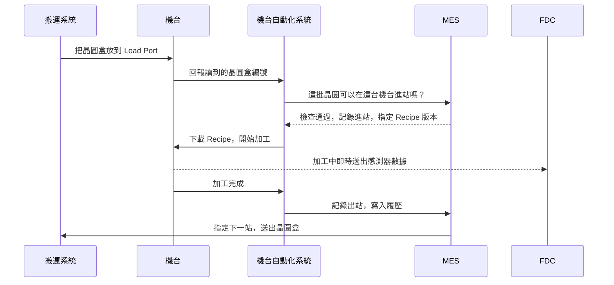

# 第 23 章　工廠如何被系統管理：一片晶圓為什麼不會走錯路

> 📍 **晶圓位置**
>
> - 前一站：跟著晶圓走完了整趟旅程
> - **本章：從系統的角度重新看一次工廠**
> - 下一站：晶片出貨後，製程如何影響韌體

---

## 一座不可能靠人記住的工廠

前面二十二章，我們跟著一片晶圓從砂子走到封裝。這一章換個位置：站在工廠中央，看它怎麼被管住。

一座 300 mm 晶圓廠裡，同時在生產的晶圓有好幾萬片，換算成數千批；每一批平均還要走數百個步驟；廠內數百到上千台機台，各有自己的狀態、腔體、Recipe 和保養排程。

只算「這批下一步去哪」就有數百種答案；再加上「哪一台做」「哪個版本的 Recipe」「現在能不能做」，這個組合已經到了記不住的量級。

這是組合爆炸，不是記性問題。

而且工廠不是靜止的：機台會故障、會保養、會被量測結果停用；產品會加急、會被扣留。任何變動，都會讓排好的順序失效一次。

所以現代晶圓廠的做法不是「想辦法記住」，而是「不要讓任何人需要記住」：狀態進系統，規則寫成程式，人只判斷例外。

工廠裡的在製品叫 WIP，是廠長每天最先看的數字之一：太少，機台會閒著；太多，每一片都要排更久。

---

## 為什麼單位是「批」，不是「片」

系統追蹤的最小單位不是一片晶圓，是一批。

一片晶圓在廠裡要走兩三個月，若每一片都獨立派工、獨立記錄，紀錄量是批次追蹤的二十五倍，好處卻幾乎是零——同一批的二十五片，走同一條路、同一台機、同一個 Recipe，連量測都只抽幾片代表整批。

批也是實體單位。晶圓裝在盒子裡移動，一個前開式晶圓傳送盒（Front Opening Unified Pod，FOUP）裝二十五片，天車搬的是盒子，不是片子。系統若以「片」為單位，每次搬運都要重新對應「這二十五片在哪個盒子裡」，多一層出錯機會。

批也是責任單位：出了問題，被扣下、要檢討的都是整批。

---

## 工廠裡的主要系統

| 系統 | 負責什麼 | 比喻 |
|---|---|---|
| MES（製造執行系統） | 記錄每批晶圓在哪裡、下一步是什麼，控制每一次進出站 | 工廠的大腦和帳本 |
| 機台自動化系統 | 連接機台與 MES，下載 Recipe、啟動製程、收集數據 | 機台的翻譯員 |
| 物料搬運系統 | 指揮天車和倉儲，把晶圓盒送到正確的位置 | 物流中心 |
| 派工系統 | 決定每台機台下一批要做哪一批晶圓 | 交通號誌 |
| Recipe 管理系統 | 管理每台機台的 Recipe 和版本 | 食譜資料庫 |
| 製程控制系統 | SPC、FDC、R2R，監控與控制製程品質 | 品管員 |
| 良率分析系統 | 整合製程和測試數據，分析良率 | 偵探 |
| 設備狀態管理 | 追蹤機台是生產、待機、保養還是故障 | 打卡鐘 |
| 資料平台 | 把機台、量測、測試的資料收進同一個地方 | 倉庫 |
| 報表與看板 | 把資料變成每天要看的那幾個數字 | 儀表板 |

十個系統裡只有一個是「紀錄的正本」，就是 MES；其他系統各負責一件事，都不持有最終真相。

這個分工最容易被破壞。只要有人為了方便，在別的系統裡也存一份「這批應該在哪」，工廠就有第二個真相——兩個真相一定會分岔，分岔那天就是帳實不符。

> [!NOTE]
> **📖 名詞｜MES（Manufacturing Execution System，製造執行系統）**
>
> - **定義**：管理生產現場的核心系統，記錄每批晶圓的位置、狀態與歷程，並控制晶圓能不能進入下一個步驟。
> - **現場用法**：「MES 上這批顯示 Hold，要先查原因。」
> - **相關名詞**：Track-in、Track-out、Route、Hold、派工
> - **常見混淆**：MES 不等於工廠的所有系統。它是核心，但機台連線、搬運、派工、製程控制通常由其他系統負責，彼此互相配合。

---

## 系統的骨架：誰有權，誰只是傳話

上面那張表拆開，只有三種角色。

**紀錄**：MES。它知道這批晶圓現在在哪、走過哪些站、下一步是什麼；這是正本，其他系統都要能和它對上。

**命令**：也是 MES 發出的。MES 說「可以進站」，機台才會動；MES 說「用第三版 Recipe」，機台才下載第三版。

**手腳**：機台自動化系統、搬運系統、機台本身。它們執行，但不判斷。機台只認得「現在要做什麼」，不認得「這批該不該做」。

這個分界是工廠運作的基礎。一旦執行者也能判斷，責任就散了。

最常見的破口是「快取」。機台自動化系統為了效率，會把 Recipe 清單暫存在自己這一方；暫存沒錯，錯的是沒有失效機制。MES 改了版，快取還留著舊的，下次進站就用錯版本——而系統記錄的版本是對的，實際跑的是舊的。

第二個破口是面板上的手動修改。工程師把某個時間參數改長兩秒，機器照做，產品也過了，但修改不會回寫 MES。三個月後客戶問「這批的實際條件」，工廠答不出來。

所以版本管理不是檔案管理，是權限管理：誰能改、改了要不要重驗、舊版留不留。沒處理好，Recipe 只是看起來整齊的檔案。

---

## 一批晶圓到站時，發生了什麼事

以一批晶圓抵達一台蝕刻機為例：

1. 天車把晶圓盒放到機台的 Load Port，機台讀取晶圓盒上的編號。
2. 系統逐一確認：這批晶圓現在應該在這一站嗎？這台機台可以做這個產品嗎？機台狀態正常嗎？晶圓有沒有被 Hold？Q-Time 有沒有超過？晶圓盒的污染等級和機台相符嗎？
3. 確認通過後，系統才把正確版本的 Recipe 下載到機台，並核對版本編號。
4. 系統記錄**進站**，機台開始加工。
5. 加工過程中，機台把感測器數據即時送給 FDC 監控。
6. 加工完成後記錄**出站**，把使用的機台、腔體、Recipe、時間寫入這批晶圓的履歷。
7. 系統依 Route 決定下一站；如果需要量測，先送量測站，結果回寫之後才繼續。
8. 搬運系統把晶圓盒送過去，或先送進倉儲等待。

注意順序：**先確認，才下 Recipe**。反過來先把 Recipe 放著，機台可能自己開始跑——那時這批可能已被 Hold、超過 Q-Time，或改派到別的站。Recipe 放在機台上，就是一個隨時會被執行的指令。

> [!NOTE]
> **📖 名詞｜進站與出站（Track-in / Track-out）**
>
> - **定義**：進站是晶圓開始在某一站加工時，在系統上的登記；出站是完成加工後的登記，並把晶圓推進到下一個步驟。
> - **現場用法**：「這批進站之後機台就 Down 了，要處理一下帳。」
> - **相關名詞**：MES、Route、履歷
> - **常見混淆**：系統上的狀態和實體晶圓必須一致。系統顯示已出站、但晶圓其實還沒做完，就是現場說的「帳實不符」，必須立即處理。

機台來自不同廠商，業界因此制定共同的通訊標準，最常見的是 **SECS/GEM**。沒有它，每台機台都要寫專屬連線程式；標準的價值不在技術高明，而在讓「換機台」變成可預期的事。

---

## 防呆：讓錯誤無法發生

第 2 步的每一項確認，都是一條**防呆規則**。例如：

- 晶圓不在這一站，就不能進站。
- 機台沒有通過驗證，就不能做這個產品。
- Recipe 版本不對，就不能開始。
- Q-Time 超過、或晶圓被 Hold，就不能繼續。
- 接觸過銅的晶圓盒，不能放上前段的機台。

這些規則其實分成四個層次，越往上越可靠：

| 層次 | 做法 | 擋下什麼 |
|---|---|---|
| 物理 | 不同尺寸的晶圓盒放不進裝載埠；氣體接頭規格不同 | 接錯、放錯、裝錯 |
| 機台 | 機台讀到不認得的產品編號就不啟動 | 跑錯產品、用錯程式 |
| 系統 | MES 檢查站點、Recipe、Q-Time、Hold、污染等級 | 走錯路、帶病進站 |
| 流程 | 兩人覆核、例外申請單、變更審查 | 判斷失誤、便宜行事 |

物理防呆最好，因為它不依賴任何人記得；系統防呆次之，它依賴規則寫得對；流程最弱，因為它依賴人在疲倦時照做。但流程不能拿掉——總有系統沒預期到的狀況，重點是判斷要留下紀錄。

> [!TIP]
> **🔧 Know-how｜每一條防呆規則背後，通常都有一次事故**
>
> - **情境**：急件趕著出貨，有人希望暫時跳過某個系統檢查。
> - **做法**：例外處理必須經過正式的申請和核准，並且留下紀錄，事後也要檢討規則是否需要調整。
> - **為什麼**：很多規則都是從過去的事故學來的。規則看起來麻煩，往往是因為它擋下的錯誤很少再發生，大家已經忘了它為什麼存在。
> - **沒做會怎樣**：同樣的事故再次發生，而且因為規則被跳過，事後也很難追查。
> - **相關章節**：[第 18 章 異常處理與工程變更](../../4-yield-and-quality/18-abnormality-handling/README.md)

---

## Q-Time：一條看不見的時鐘

工廠裡有一類規則不是「不能做」，而是「不能等」。兩個步驟之間允許等待的最長時間叫 Q-Time；它不是產能手段，是材料科學的要求：晶圓停在空氣裡，表面會一直變。

- 清洗完、還沒進爐管的晶圓，表面會重新長出原生氧化層，也會吸附有機物。
- 微影曝光完、還沒顯影的晶圓，光阻裡的酸會繼續擴散，圖形會慢慢變形，也就是[第 4 章](../../2-process-modules/04-lithography/README.md)講的曝後等待時間。
- 蝕刻完的晶圓，暴露出來的金屬或矽表面會被空氣和水氣腐蝕。
- 沉積完的多孔薄膜會吸水，後面的製程會出氣、會剝離。

變化速度差很大，有些能等幾小時，有些只有幾十分鐘，所以 Q-Time 是每段路徑各自訂的。逾時也不是「一定壞」，是「壞的機率上升」——這讓它特別難管：逾時的晶圓外觀正常、量測也過，問題要到後段甚至測試才出現。

所以工廠把它交給系統：每批剩餘時間都算得出來，派工把快逾時的排前面，超過的直接擋下。

> [!NOTE]
> **📖 名詞｜Q-Time（Queue Time，等待時間限制）**
>
> - **定義**：兩個步驟之間允許等待的最長時間，超過就必須擋下、重工或報廢。
> - **現場用法**：「這批 Q-Time 只剩四十分鐘，先跑它。」
> - **相關名詞**：原生氧化層、PED、派工、Hold
> - **常見混淆**：Q-Time 講的是「兩個特定步驟之間」的限制，不是整個流程的總時間。整批從投片到完成花的時間叫 Cycle Time，兩者常被混著講。

---

## 履歷：每一片晶圓的完整紀錄

系統為每一片晶圓留下完整的**履歷**：經過哪些步驟、用了哪台機台和腔體、哪個 Recipe 版本、什麼時間、量測結果。

履歷的價值在於回答三種完全不同的問題：

- **這片去過哪裡**：客戶回報問題時，從一顆晶片追回它的晶圓、批次和每一站的生產條件。
- **這台做過誰**：機台出問題時，反向找出受影響的範圍，見[第 18 章](../../4-yield-and-quality/18-abnormality-handling/README.md)。
- **那個時間發生了什麼**：良率異常時做共通性分析，見[第 16 章](../../4-yield-and-quality/16-yield-analysis/README.md)。

三種問法對資料的要求不同：第一種要全，第二種要快，第三種要能跨系統對照。所以履歷不是一張表，是好幾個系統被同一個鍵串起來，通常是晶圓編號——這也是編號要雷射刻在晶圓上的原因：盒子會換，晶圓不會。

保存多久是現實問題。客戶合約通常要求數年，這段時間裡系統要換版、資料要搬遷，履歷不能某天變成讀不出來的檔案。

---

## 一座工廠的排隊學

晶圓廠的生產管理，大部分時間在處理「排隊」。

一片晶圓走完數百站，真正被加工的時間只有幾小時到幾十小時；它在廠裡待的兩三個月，絕大部分花在等待、搬運、卡在機台前。

這是必然的：機台共用、各站產能不同，總有某一站比較慢。

於是有三個數字要不斷權衡：

| 數字 | 意思 | 變大代表什麼 |
|---|---|---|
| WIP | 現在有多少晶圓在廠裡 | 產出潛力大，但排隊也長 |
| Cycle Time | 一批從投片到完成要多久 | 交期變長，客戶等待變久 |
| Move | 每天完成多少個步驟 | 產出快，但可能只是搬得多 |

這三個數字不能同時好看。WIP 拉高，機台不閒著，但每片等待變長；Cycle Time 壓短，就得減少 WIP，機台又出現空檔。

工程師於是把注意力放在**瓶頸站**：全廠產出被最慢的那一站決定。瓶頸站多一小時產能，全廠就多一小時；非瓶頸站多一小時，只是多一小時空閒。

> [!TIP]
> **🔧 Know-how｜為什麼「顧好瓶頸」比「照顧每一台」有效**
>
> - **情境**：工廠要提升產出，資源有限，不知道該先改善哪一站。
> - **做法**：先找出長期滿載、前面總是在排隊的那一站。把資源放在那裡：優先保養、優先備品、優先派人。
> - **為什麼**：整條線的產出等於最慢那一站的速度。其他站再快，也只是提早排到瓶頸前面等。
> - **沒做會怎樣**：各站各自提升效率，帳面上每個數字都變好，出貨量卻沒變——因為貨全堆在瓶頸站前面。
> - **相關章節**：[第 1 章 晶圓廠如何運作](../../0-before-you-start/01-how-a-fab-works/README.md)

還有一個副作用：Move 是「完成的步驟數」，不是「完成的產品數」。晶圓在兩座倉庫間多搬幾次，Move 就上升，出貨卻沒變。指標一旦變成考核項目，就會被朝著指標本身優化。

---

## 數據與智慧製造

一座晶圓廠每天的數據量非常龐大：機台感測器、量測結果、測試結果、生產紀錄。這些數據正被用來做更多事情：

- **預測性保養**：從機台數據的變化，預測零件什麼時候需要更換。
- **虛擬量測**：根據機台在加工時的數據，推估量測結果，減少實際量測的次數。
- **人工智慧分析**：自動辨識晶圓圖的型態、找出良率損失的原因。
- **自動化派工**：根據即時狀態，自動決定最佳的生產順序。

這四件事的前提都是資料要對得上。虛擬量測的模型用「機台數據」對應「實際量測值」訓練；量測若延遲一天回寫，模型學到的就是一天前的製程，一漂移就開始說謊——而且不會告訴你。

預測性保養也一樣。它需要「正常」與「即將故障」兩種樣本，後者天生很少，所以多數工廠實際做的是異常偵測——判斷現在和過去不一樣，而不是預測哪天會壞。

> [!TIP]
> **🔧 Know-how｜系統停擺，工廠就停擺**
>
> - **情境**：MES 突然當機。
> - **做法**：核心系統採用備援架構，系統的修改要經過完整測試，並安排在影響最小的時段上線；工廠也會事先準備系統停擺時的應變程序。
> - **為什麼**：晶圓的每一次進出站都要經過系統，系統一停，機台就算正常也無法繼續生產。
> - **沒做會怎樣**：整座工廠停線，正在等待的晶圓還可能因為超過 Q-Time 而需要重工或報廢。
> - **相關章節**：[第 9 章 清洗與污染控制](../../2-process-modules/09-cleaning/README.md)

---

## 系統出錯的時候

系統出錯的地方不只一種，下面是現場最常處理的幾種：

| 異常 | 可能原因 | 結果 |
|---|---|---|
| 帳實不符 | 進出站漏記、機台當機、人工搬運未登記 | 追溯斷鏈，只能整批隔離 |
| Recipe 版本錯 | 快取未更新、面板手動修改未回寫 | 整批參數偏移，量測才發現 |
| 進站被擋 | 站點錯、Q-Time 逾時、Hold 未解除 | 停線等待，週期拉長 |
| 派工失衡 | 優先順序設定錯誤、急件不斷插隊 | 部分機台閒置、部分站塞車 |
| 資料延遲 | 網路或資料庫瓶頸 | FDC 來不及攔，事後才發現 |
| 系統停擺 | MES 或網路中斷 | 全廠停線 |
| 履歷缺漏 | 感測器或介面漏抓、欄位未定義 | 事後無法追溯，稽核不通過 |
| 權限失控 | 例外核准沒有期限、沒有回收 | 規則被一點一點繞過 |

最難處理的是前兩種。帳實不符同時是資料問題和實體問題：系統說晶圓在倉庫，實際它在某台機台的腔體裡——先信實體，再回頭修資料，並把這段期間經過這台機器的批次全部隔離。

Recipe 版本錯更麻煩，因為它不會馬上出錯：參數偏了一點，產品還是過，量測也還在規格內，等偏移累積到看得出來，已經做了好幾十片。

所以工廠的態度一樣：寧可停線，不要帶著不確定的帳繼續跑——停線的代價算得出來，帶著錯帳生產的代價算不出來。

---

## 本章重點

1. 晶圓廠的複雜度遠超過人力能掌握，每個動作都由系統指揮和記錄。
2. MES 是紀錄的正本，其他系統負責命令、執行或分析，都不持有第二份真相。
3. 晶圓進站前，系統會檢查步驟、機台、Recipe、Q-Time、Hold 和污染等級，確認通過才下 Recipe。
4. 防呆分物理、機台、系統、流程四層，越靠物理越可靠；Q-Time 則是「不能等」的那一類規則。
5. 每片晶圓的履歷是良率分析、異常處理與客戶追溯的基礎；工廠產出則被瓶頸站決定。

---

## 延伸閱讀

- Wallace J. Hopp、Mark L. Spearman，《Factory Physics》，生產週期、在製品與產能的基本觀念
- Heiko Meyer、Franz Fuchs、Klaus Thiel，《Manufacturing Execution Systems: Optimal Design, Planning, and Deployment》
- Lars Mönch、John W. Fowler、Stéphane Dauzère-Pérès、Scott J. Mason、Oliver Rose，〈A Survey of Problems, Solution Techniques, and Future Challenges in Scheduling Semiconductor Manufacturing Operations〉，*Journal of Scheduling*，2011
- SEMI E10，設備可靠度、可用率與狀態的定義
- SEMI E5、E30、E37，機台通訊標準（SECS-II、GEM、HSMS）

---

[← 上一章：第 22 章 最終測試與可靠度](../../5-backend/22-final-test-and-reliability/README.md) ｜ [目錄](../../README.md) ｜ [下一章：第 24 章 製程如何影響韌體 →](../../6-beyond-the-fab/24-process-and-firmware/README.md)
